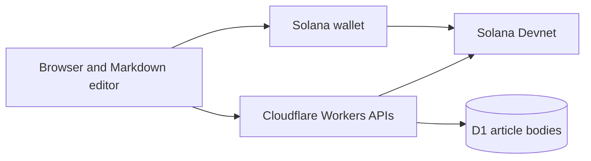

# FOLIO · Solana Long-Form Forum

Share thoughtful Markdown articles, discuss ideas on-chain, and support creators with direct SOL tips.

**Live app:** [folio-solana-notes.yebai.chatgpt.site](https://folio-solana-notes.yebai.chatgpt.site/)

**Network:** Solana Devnet. All current payments use development tokens with no real monetary value.

FOLIO is designed for writers, researchers, developers, and readers who value long-form content and meaningful conversations. Reading is public; publishing, replying, and tipping use a connected Solana wallet.

## Product modules

| Module | Current functionality |
| --- | --- |
| Content creation | Markdown editor, formatting shortcuts, live reading preview, local drafts, and long articles up to 200,000 characters / 500,000 UTF-8 bytes. |
| Community discussion | Public article feed, author pages, personal articles, shareable links, wallet-signed replies, and quoted replies. Search covers articles already loaded. |
| Creator support | Direct Devnet SOL tips, preset and custom amounts, zero platform commission, and transaction receipts. Network fees still apply. |
| Wallet and appearance | MetaMask Connect for Solana, Wallet Standard support, Devnet balances, and light / dark / system themes. |

Markdown supports headings, lists, blockquotes, code blocks, GFM tables, task lists, footnotes, links, and external images. Raw HTML is not executed. Images remain external resources; their files are not uploaded to the article database.

## How Solana is used

Full article bodies are stored **off-chain in Cloudflare D1**. Solana records wallet-signed article metadata and SHA-256 content hashes, which link the stored body to its publisher's transaction. The reader recalculates the hash before displaying an article.

Replies use signed Memo transactions associated with the original article. Tips use direct System Program transfers to the original on-chain publisher's wallet. The application reuses deployed Solana programs; it does not deploy a custom smart contract.



- **Article / reply protocol:** `folio:forum:v1:` Memo payloads.
- **Tip protocol:** `folio:tip:v1:` Memo payloads plus an exact SOL transfer.
- **Memo program:** `MemoSq4gqABAXKb96qnH8TysNcWxMyWCqXgDLGmfcHr`.
- Forum transactions use a zero-lamport self-transfer with a read-only reference for indexing. Memo accounts themselves must sign.
- Article and reply transactions allow only the expected Memo, indexing transfer, and bounded compute-budget instructions. Tips have a separate policy for the expected recipient and amount.
- A pending transaction retains its known signature before broadcast. An uncertain network result is resolved by querying that signature, without automatically signing a new payment or publication.
- Article storage accepts a body only after the corresponding transaction is confirmed and its content hash matches. Retrying body storage does not require another on-chain transaction.
- Tipping success requires both confirmation and matching on-chain payment details. Amounts support up to nine decimal places, with a maximum of 10 Devnet SOL per tip.

These checks establish the signing wallet and content integrity; they do not verify an author's real-world identity or the factual accuracy of an article.

## Technology

- React 19, TypeScript, Vinext, Vite, and Tailwind CSS.
- Cloudflare Workers for backend APIs; Cloudflare D1 with Drizzle migrations for article storage.
- `@solana/web3.js`, Wallet Standard, and `@metamask/connect-solana`.
- `react-markdown` and `remark-gfm` for Markdown rendering.
- OpenAI Sites for the current hosted deployment and source / version management.
- OpenAI Codex for AI-assisted implementation, debugging, and interface design.

## Local development

Requires Node.js **22.13 or later** and npm.

```sh
npm ci
npm run dev
```

The portable development entry uses port **5173**. To use a dedicated Devnet RPC endpoint, copy `.env.example` to `.env` and set `SOLANA_DEVNET_RPC_URL`. Provider credentials belong in local environment files or the hosting platform's secret configuration, never in browser code or Git.

```sh
npm run build
npm run start
```

Article persistence requires an initialized D1 binding named **`DB`**. The schema is in `db/schema.ts`, and the initial migration is `drizzle/0000_cloudy_storm.sql`. Apply the existing migrations to the appropriate local or hosted database before using article storage. The current Sites deployment provisions its binding and applies versioned migrations; a new deployment needs its own database configuration. The application does not create tables during requests.

`.openai/hosting.json` declares the original Sites project and the `DB` binding. Cloning this repository does not copy its hosted database, runtime environment variables, or deployment access. Keep that distinction in mind when deploying a fork.

## Source layout

```text
app/
  forum.tsx                    Article feed, editor, reader, and discussions
  forum-wallet.tsx             Wallet connection and account panel
  article-markdown.tsx         Markdown rendering
  article-tipping.tsx          Tip dialog and payment receipts
  theme-control.tsx            Appearance controls
  api/articles/               Article storage and retrieval
  api/rpc/route.ts             Restricted Devnet RPC proxy
lib/
  articles.ts                 Body normalization and content hashes
  forum.ts                    Forum publishing and chain reads
  forum-protocol.ts           Shared forum transaction policy
  forum-server.ts             Trusted topic reads and D1 access
  tip-protocol.ts             Amount parsing and tip transaction policy
  tipping.ts                  Tip publishing and confirmation
  devnet-rpc.ts               Bounded retry for temporary RPC failures
db/schema.ts                  Article database schema
drizzle/                      Versioned database migrations
build/, scripts/, vendor/     Hosting and development support
```

The previous short-journal page has been removed. Some legacy protocol helpers remain for compatibility; the current product is the long-form forum.

## Current scope

- **Devnet only:** real-value payments and mainnet publishing are not available.
- Published article versions and replies are immutable in the current application.
- Devnet may reset, and public RPC providers may throttle requests or lack older history.
- Article bodies depend on hosted D1 storage. On-chain hashes provide verification, not a guarantee of permanent or fully decentralized storage.
- Local drafts and pending receipts belong to the current browser. Keep separate backups of important writing.
- Uploaded repository contents include source and assets, not database exports, imported article bodies, wallet key files, runtime credentials, or build caches.

## 中文简介

FOLIO 是一个围绕优质长文构建的 Solana 论坛，包含 **内容创作、社区讨论、创作者支持** 三个核心模块。用户可以用 Markdown 发布文章，通过钱包签名参与链上讨论，并使用开发网 SOL 直接打赏作者。

全文保存在 Cloudflare D1，链上记录发布钱包、文章摘要和内容指纹。当前版本使用 Solana 开发网，所有打赏均为测试代币。界面采用炭黑、暖白与芥末黄的纸片风格，支持浅色、深色和跟随系统。

## References and notices

- [Solana Memo documentation](https://www.solana-program.com/docs/memo)
- [Solana Pay reference convention](https://docs.solanapay.com/spec#reference)
- [Solana clusters](https://solana.com/docs/references/clusters)
- [Wallet Standard](https://github.com/anza-xyz/wallet-standard)
- [MetaMask Connect for Solana](https://docs.metamask.io/metamask-connect/solana/)

Retained third-party license notices are in `build/sites-vite-plugin.LICENSE` and `vendor/shadcn-tailwind-4.13.0.LICENSE.md`. Dependency licenses remain those of their respective projects.
